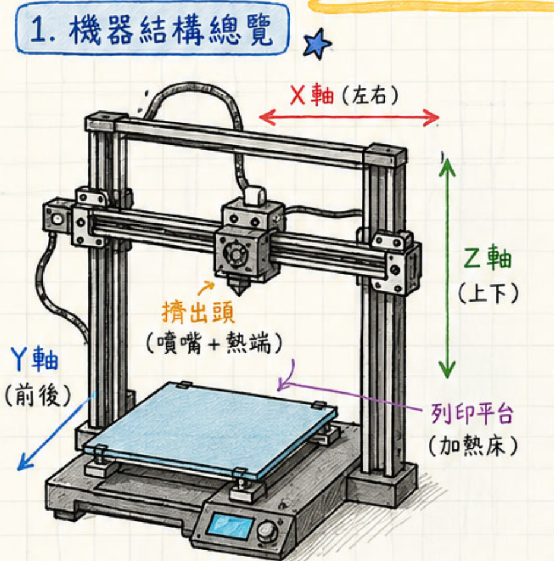
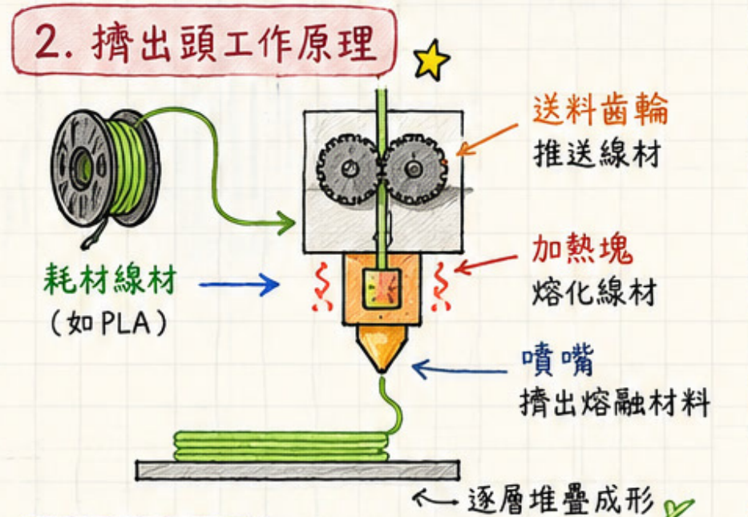
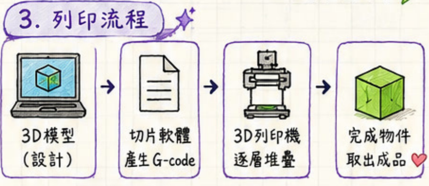
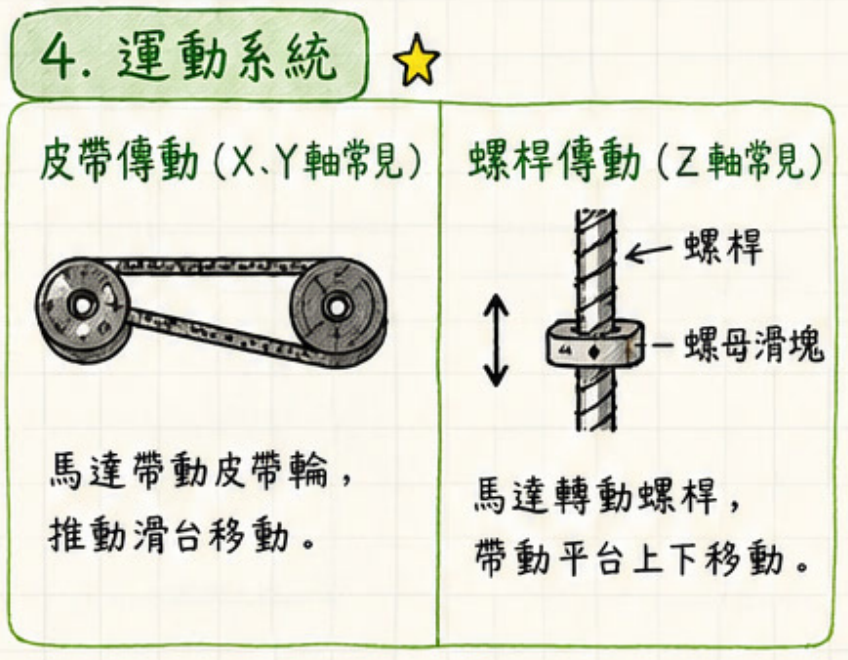
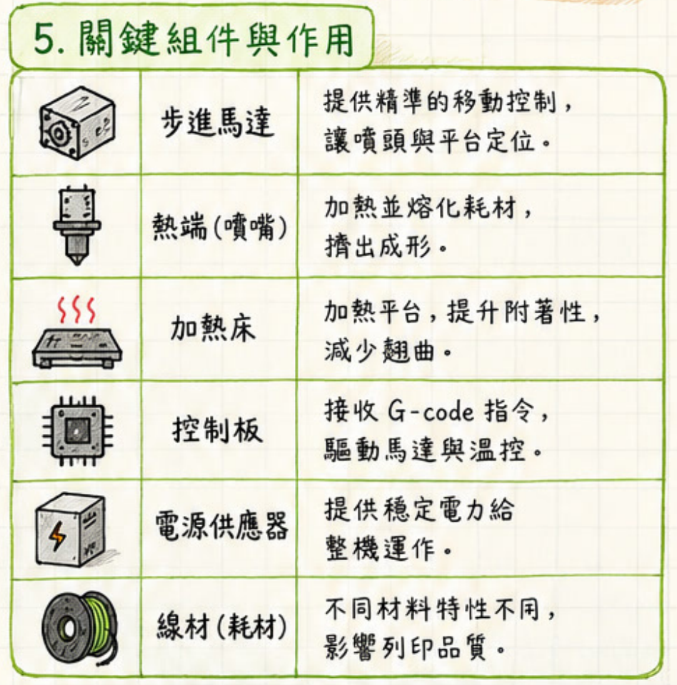
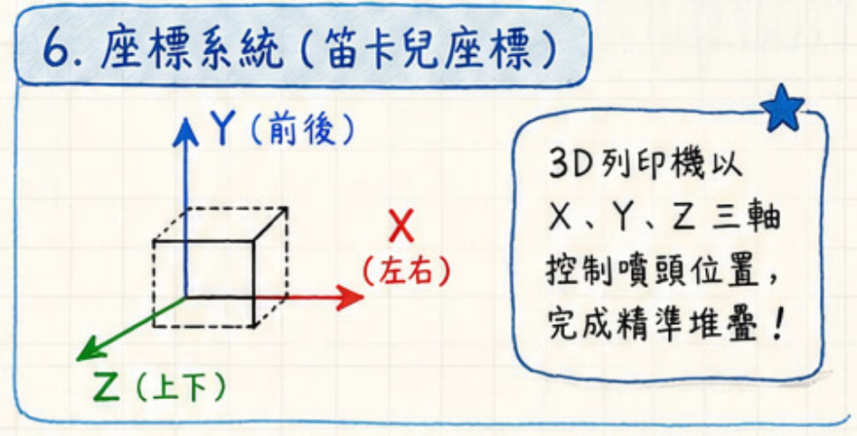
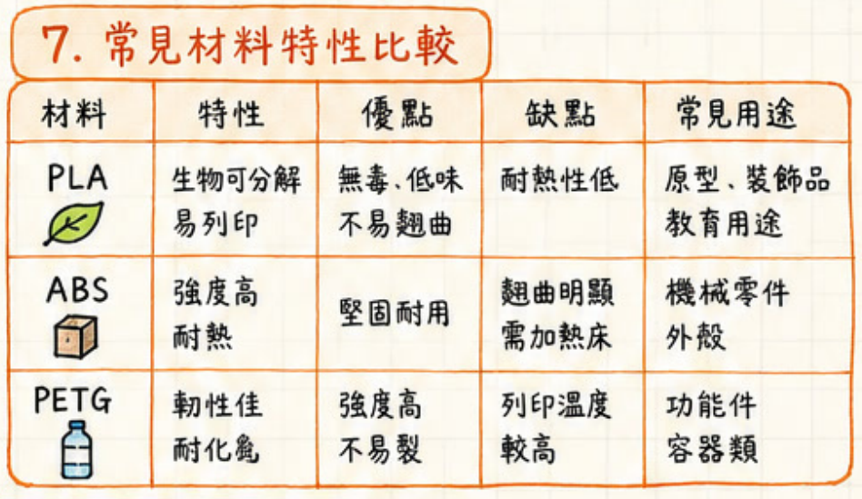
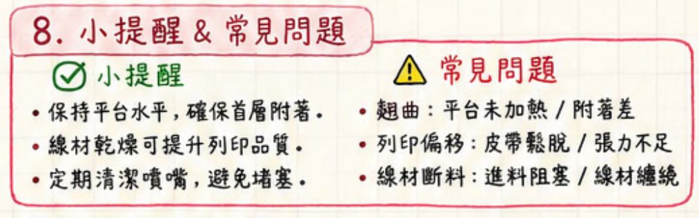

> 來源：使用者提供的《3D列印機器原理.pdf》第 1 頁。以下依原圖九個主題改寫為段落式講義，保留原圖資訊，另以「閱讀提醒」標示容易誤解的內容。本文所述為原圖的線材熔融擠出式列印機。

[TOC]

## 學習目標

閱讀後，你應能說明線材如何變成實體物件、辨認列印機主要組件、理解 X／Y／Z 三軸的作用，並依材料特性與列印現象提出初步檢查方向。

## 1. 機器結構總覽

3D 列印機將數位模型轉換為實體物件。原圖中的機器利用三軸運動定位噴嘴，讓加熱後的材料沿指定路徑擠出，並在列印平台上逐層堆疊。

機器可從三個部分觀察：支撐與導引移動的機架、負責送料與加熱的擠出系統，以及承接列印物件的平台。列印平台若具加熱功能，也稱為加熱床。各部分需互相配合，才能在正確位置放置材料。

| 位置／部件 | 原圖標示 | 功能 |
| --- | --- | --- |
| X 軸 | 左右 | 控制左右方向的相對移動 |
| Y 軸 | 前後 | 控制前後方向的相對移動 |
| Z 軸 | 上下 | 改變列印高度，配合各層堆疊 |
| 擠出頭 | 噴嘴＋熱端 | 將熔融材料擠出 |
| 列印平台 | 加熱床 | 承接首層與後續堆疊的物件 |

> **閱讀提醒：** 原圖以「擠出頭（噴嘴＋熱端）」概括標示列印頭。學習時仍應區分推進線材的送料部分，以及加熱並擠出材料的熱端／噴嘴。

*圖 1：先辨認噴嘴與平台，再觀察三軸如何改變兩者的相對位置。*

## 2. 擠出頭的工作原理

列印材料通常以線材捲的形式供應，原圖以 PLA 為例。線材進入送料機構後，送料齒輪持續推進線材，使材料進入加熱區。加熱塊使線材熔融，噴嘴再把熔融材料擠出到平台或已完成的材料層上。

這個過程可分成「送料 → 加熱熔融 → 噴嘴擠出 → 逐層堆疊」四個步驟。噴嘴移動路徑決定材料放在哪裡，送料則決定材料能否持續供應；兩者必須協調，才能形成模型的輪廓與內部結構。

| 部分 | 作用 | 觀察重點 |
| --- | --- | --- |
| 耗材線材 | 提供成形材料 | 是否順暢進入送料路徑 |
| 送料齒輪 | 推進線材 | 是否能穩定送料 |
| 加熱塊 | 加熱並熔融線材 | 加熱與送料需配合 |
| 噴嘴 | 擠出熔融材料 | 材料是否能順暢擠出 |

*圖 2：沿著線材路徑閱讀，理解材料從固態線材到堆疊成形的過程。*

## 3. 從模型到成品的列印流程

列印流程從 3D 模型開始。設計完成後，將模型交給切片軟體處理，產生機器可執行的 G-code 指令。列印機接收指令後，控制運動與擠出，逐層製作物件，最後取出成品。

| 順序 | 階段 | 工作內容 |
| --- | --- | --- |
| 1 | 3D 模型／設計 | 決定物件的形狀 |
| 2 | 切片軟體 | 把模型轉成逐層列印所需的 G-code |
| 3 | 3D 列印機 | 執行指令，以逐層堆疊方式成形 |
| 4 | 完成物件 | 取出成品並觀察列印結果 |

原圖的控制板說明也提到 G-code：它是連結軟體規劃與硬體動作的指令。模型描述「要做出的形狀」，切片產生「機器要如何製作」，列印機則實際完成動作。

*圖 3：依箭頭順序閱讀，分辨設計、指令與實體製作三個層次。*

## 4. 運動系統：皮帶與螺桿

運動系統把馬達旋轉轉換成滑台、噴頭或平台的直線移動。原圖比較兩種常見方式：皮帶傳動與螺桿傳動。

皮帶傳動由馬達帶動皮帶輪，再透過皮帶推動滑台移動。原圖指出，X、Y 軸常採用這種方式。若皮帶鬆脫或張力不足，可能出現列印偏移，因此皮帶狀態也是故障檢查的重點。

螺桿傳動則由馬達轉動螺桿，使螺母滑塊沿螺桿移動。原圖指出，Z 軸常採用螺桿傳動，並以帶動平台上下移動為例。

| 傳動方式 | 動作關係 | 原圖中的常見用途 |
| --- | --- | --- |
| 皮帶 | 馬達 → 皮帶輪 → 皮帶 → 滑台 | X、Y 軸 |
| 螺桿 | 馬達 → 螺桿旋轉 → 螺母滑塊移動 | Z 軸 |

> **閱讀提醒：** 圖中「平台上下移動」是一種示例。辨認機器時，應以實際機構為準，觀察噴頭與平台如何共同形成三軸的相對移動。

*圖 4：比較兩種機構如何把旋轉運動轉成直線運動。*

## 5. 關鍵組件與作用

列印機需要定位、加熱、供電、控制與材料供應等功能共同運作。可用下表把各組件與任務配對。

| 組件 | 主要作用 | 與列印的關係 |
| --- | --- | --- |
| 步進馬達 | 提供移動控制 | 讓噴頭與平台定位 |
| 熱端／噴嘴 | 加熱熔融耗材並擠出 | 完成材料的熔融與成形 |
| 加熱床 | 加熱平台 | 提升附著性、減少翹曲 |
| 控制板 | 接收 G-code，驅動馬達並進行溫控 | 協調運動與加熱 |
| 電源供應器 | 提供穩定電力 | 支援整機運作 |
| 線材／耗材 | 提供列印材料 | 材料特性會影響列印品質 |

從系統角度看，控制板依 G-code 指令協調馬達與溫控；馬達負責定位，熱端負責熔融與擠出，加熱床協助材料附著，電源供應器則支援各部分運作。任何一個環節失常，都可能反映在成品上。

*圖 5：將組件名稱與功能配對，建立機器的整體概念。*

## 6. 座標系統：用 X、Y、Z 描述位置

原圖以笛卡兒座標說明三軸定位。X 軸表示左右方向，Y 軸表示前後方向，Z 軸表示上下方向。透過三軸位置的變化，機器將材料放到指定位置，完成精準堆疊。

列印每一層時，要控制材料在平面上的位置；進入下一層時，則要改變列印高度。理解三軸的作用，有助於把模型的空間位置與實際機器動作連結起來。

> **原圖辨讀提醒：** 第 6 區的立體座標圖把 Y 箭頭畫成向上、Z 箭頭畫成斜向，但文字與第 1 區均標示「Y＝前後、Z＝上下」。閱讀時請以文字方向為準，不要把紙面箭頭的方向直接當成機器的實際軸向。

*圖 6：本圖保留原稿；軸向請搭配上方辨讀提醒與圖 1 閱讀。*

## 7. 常見材料：PLA、ABS、PETG

材料選擇需同時考慮用途與列印條件。原圖以 PLA、ABS、PETG 三種材料比較其特性、優缺點與用途，下表依原稿整理。

| 材料 | 原稿列出的特性 | 優點 | 限制／列印重點 | 原稿列出的用途 |
| --- | --- | --- | --- | --- |
| PLA | 易列印；原稿列有生物可分解 | 原稿列有低味、不易翹曲 | 耐熱性低；其他材料敘述見下方提醒 | 原型、裝飾品、教育用途 |
| ABS | 強度高、耐熱 | 堅固耐用 | 翹曲明顯，需要加熱床 | 機械零件、外殼 |
| PETG | 韌性佳、耐化學 | 強度高、不易裂 | 列印溫度較高 | 功能件、容器類 |

> **閱讀提醒：** 原圖將 PLA 描述為「生物可分解、無毒、低味」，這些簡化詞句不宜直接當成所有產品與使用條件下的保證。本講義保留原稿比較方向，但不以「無毒」作為安全結論。實際材料條件請查閱所用線材的產品說明；「容器類」用途也不能單憑這張圖判定其食品接觸適用性。

選材時可以先問：「物件是用來展示外觀，還是承擔功能？」接著再比較耐熱、韌性、翹曲與列印條件。原稿的用途欄可作為初步分類，實際選擇仍需配合物件需求。

*圖 7：原始材料表，請連同閱讀提醒使用。*

## 8. 操作小提醒與常見問題

原稿提出三項維護重點：保持平台水平以確保首層附著、保持線材乾燥以提升品質，以及定期清潔噴嘴以避免堵塞。這些工作分別對應首層、材料狀態與擠出路徑。

遇到列印問題時，可先依成品現象分類，再檢查對應環節。下表整理原稿列出的可能原因；它們是初步檢查方向，並非完整的故障診斷清單。

| 現象 | 原稿列出的可能原因 | 初步檢查方向 |
| --- | --- | --- |
| 翹曲 | 平台未加熱、附著差 | 檢查平台加熱狀態與首層附著 |
| 列印偏移 | 皮帶鬆脫、張力不足 | 檢查皮帶與傳動狀態 |
| 線材斷料／供料中斷 | 進料阻塞、線材纏繞 | 檢查線材捲與進料路徑 |

> **用語提醒：** 原圖的「線材斷料」同時列出阻塞與纏繞，應理解為供料中斷的現象；不要只把它理解成線材本身斷裂。

*圖 8：把列印現象與平台、傳動、送料三個環節對照。*

## 9. 重點總結

原圖強調三個原理：** 機械結構、擠出加熱、精準控制**。機械結構提供支撐與運動，擠出加熱讓線材熔融並被放置，精準控制則協調位置、送料與溫控。三者配合，才能把數位模型逐層轉換成實體物件。

可用一句話串起整個流程：** 模型經切片產生 G-code，控制板協調三軸運動與加熱擠出，材料在平台上逐層堆疊，最後形成物件。**

## 課堂複習

1. 送料齒輪、加熱塊與噴嘴各自負責什麼工作？
2. 為什麼 3D 模型在送進列印機之前需要經過切片？
3. X、Y、Z 軸分別代表什麼方向？
4. 皮帶傳動與螺桿傳動如何把馬達旋轉轉成直線移動？
5. 若出現列印偏移，原稿建議先檢查哪個系統？
6. 原型、耐熱外殼與功能件，在材料選擇上各需注意哪些差異？

參考答案

1. 送料齒輪推進線材；加熱塊加熱熔融線材；噴嘴擠出熔融材料。
2. 切片軟體把模型轉成逐層製作所需的 G-code 指令。
3. X＝左右、Y＝前後、Z＝上下。
4. 皮帶透過皮帶輪帶動滑台；螺桿透過旋轉帶動螺母滑塊移動。
5. 先檢查皮帶是否鬆脫或張力不足。
6. 依原稿：PLA 常用於原型；ABS 列有耐熱與外殼用途，但需留意翹曲與加熱床；PETG 列有韌性佳與功能件用途，但需留意列印溫度。實際選材仍依產品說明與物件需求。

---

來源與整理說明：原始資料為《3D列印機器原理.pdf》第 1 頁的九區圖文；圖 1～8 均為該頁裁圖。本文將原圖文字改寫、分段並整理成表格，另加入學習目標、圖說、複習題，以及對原稿簡化敘述的閱讀提醒。
